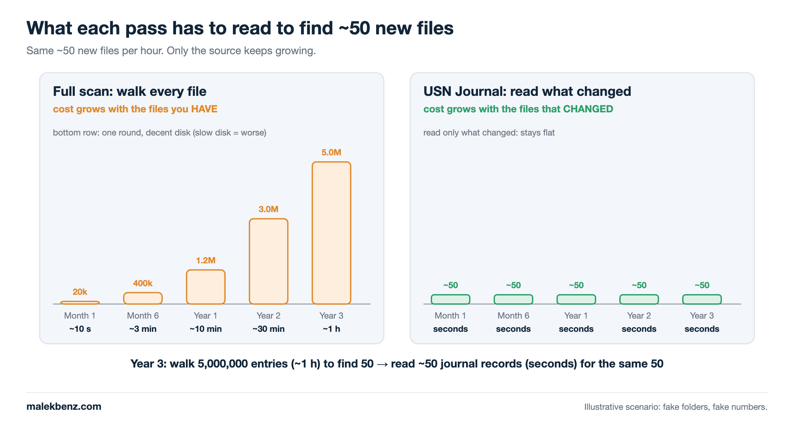
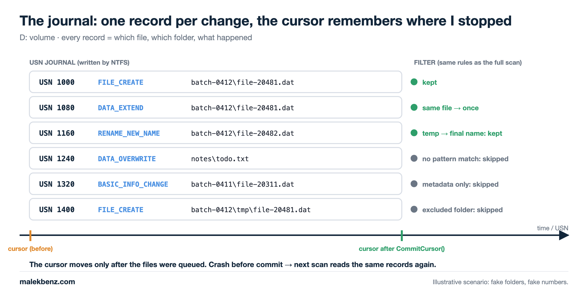
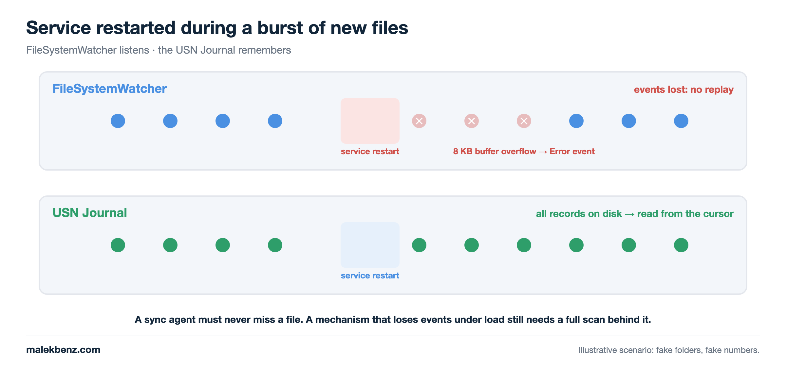
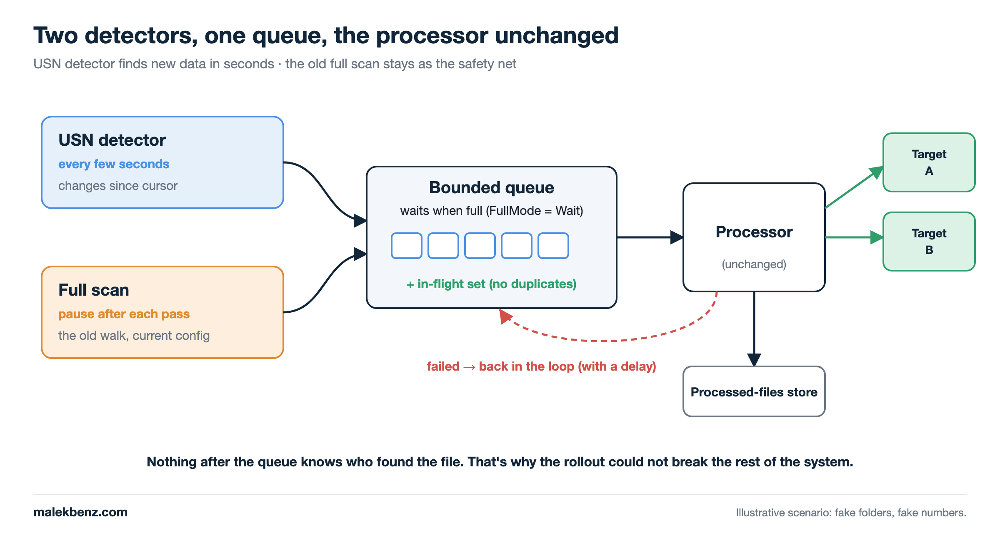
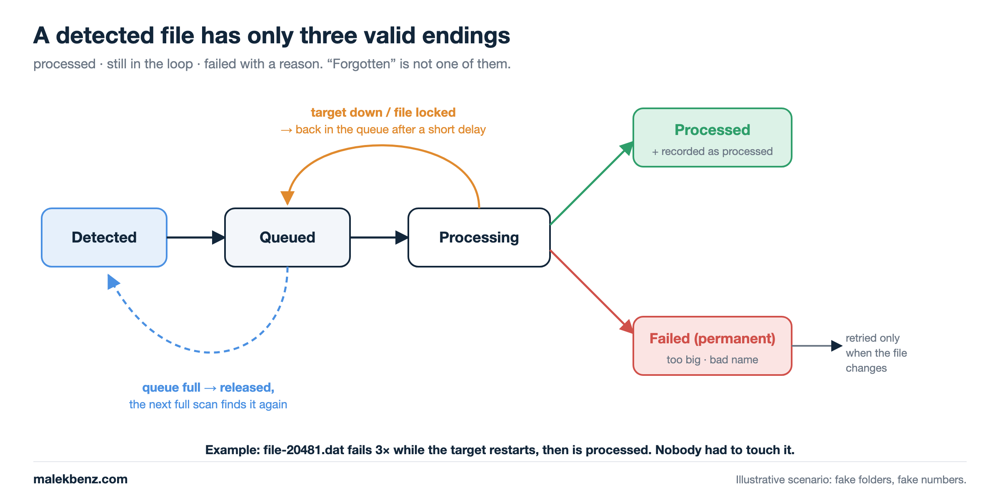
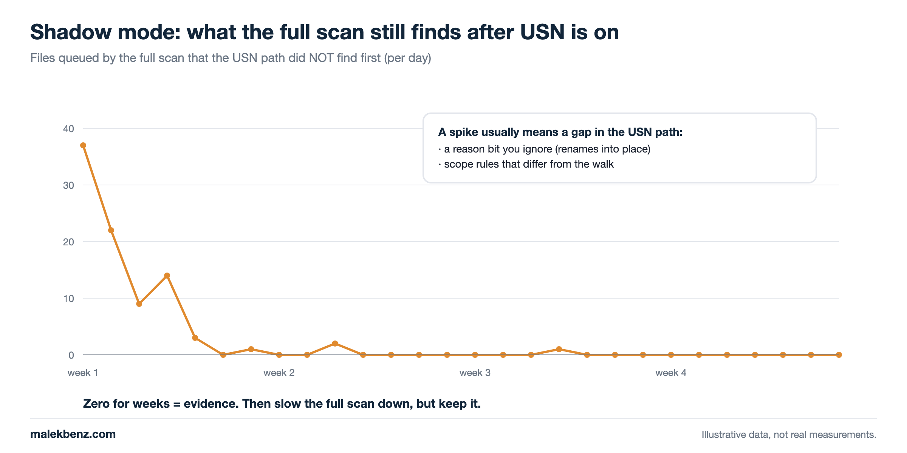

I have a service that syncs files from a **source** to a **target**. It's made of two pieces working together: the first one **detects** new incoming data, the second one **processes** it (copy it, upload it, transform it, whatever the target needs). For a long time, detection was the boring part: walk the folder, compare with what we already processed, done. Then the source grew to **millions of files**. Processing was still fast, but by the time detection finished one pass, a lot of time had gone by, and new data was just waiting to be found. **Detection had become the bottleneck.** Today: how I fixed it with the NTFS **USN Change Journal**, why I didn't use `FileSystemWatcher`, and, the most important part, how to roll it out without breaking the rest of the system.

## Two pieces, one job

Before anything else, here is the shape of the service. Keep it in mind, everything in this post is about the left side:

```sql
 ┌───────────────┐        ┌─────────┐        ┌───────────────┐
 │   DETECT      │ ─────► │  QUEUE  │ ─────► │   PROCESS     │ ─────► target
 │ what is new?  │        │         │        │ copy, upload… │
 └───────────────┘        └─────────┘        └───────────────┘
```

> **The processor doesn't care how a file was found. That one decision is what made the change safe.**

---

## Start simple, first

I want to defend the first version. It was the **right** choice:

```sql
Every N seconds:
  1. Enumerate every folder under the source (include / exclude rules)
  2. Enumerate every file matching the patterns
  3. For each file: "did we already process it, with the same size and date?"
  4. If not → queue it
```

A few lines of code, nothing to configure, no admin rights, works on network shares, and it's correct by construction: if a file is there, the walk finds it. No events to lose, no state to corrupt.

> **Always start with the simplest thing that is correct. Optimize when you can measure the problem, not when you can imagine it.**

I didn't need the journal on day one. I needed it the day the numbers said so.

### Simple, but not tangled

"Start simple" doesn't mean "put everything in one method". The first version was simple **and** separated: detecting, queuing and processing were already three different pieces, talking through one small contract:

```csharp
// Detection only answers one question: "what should be processed?"
public interface IChangeDetector
{
    IAsyncEnumerable<FileInfo> DetectAsync(CancellationToken ct);
}

// The processor only knows how to process one file. It never asks who found it.
public interface IFileProcessor
{
    Task<ProcessResult> ProcessAsync(FileInfo file, CancellationToken ct);
}
```

The full scan was just the first `IChangeDetector`. That's why, years later, adding the USN Journal was **adding a class**, not rewriting the service: the queue, the processor, the "already processed" tracking and everything around them didn't move.

> **Simplicity is about how much each piece does, not how few pieces you have. Keep the pieces separate, even when each one is tiny.**

If detection and processing had been mixed in one loop, the "small" performance change would have touched everything, and everything would have needed testing again. Separation of concerns is what makes a later change **local**.

### Don't change it until you need it

The other half of the rule: once something works, **leave it alone** until you have a reason. For a long time the full scan was "not elegant", "not the best way", and I could have replaced it on a quiet week. I didn't, because nothing was wrong with it *yet*:

- it was correct,
- it was fast enough for the size of the data,
- nobody was waiting on it.

A change without a need brings all the risk (new code, new bugs, new things to test and explain) and none of the benefit. The day the source grew and new data started waiting, the need was real, measurable, and the change was easy to justify, and easy to verify.

> **Don't change working code because you can. Change it because you must, and when you do, change one piece at a time.**

---

## Why the full scan stops scaling

The problem fits in one sentence:

> **The cost of a full scan grows with the number of files you HAVE, not with the number of files that CHANGED.**

```sql
            files in source   new per hour   one round (decent disk)   one round (slow disk)
Month 1  :       20,000          ~50         ~10 seconds               ~1 minute
Month 6  :      400,000          ~50         ~3 minutes                ~15 minutes
Year 1   :    1,200,000          ~50         ~10 minutes               ~45 minutes
Year 2   :    3,000,000          ~50         ~30 minutes               ~2 hours
Year 3   :    5,000,000          ~50         ~1 hour                   ~3 hours and more
Year 4   :    7,000,000          ~50         ...                       ... and it never stops
```

> **Note:** these are **not real measurements**. They're made-up numbers, just to show the case: how the time of one round grows with the number of files. Your numbers will be different, the shape will be the same. The middle column is a **decent** local disk. On a slow one (an old spinning drive, a busy volume, network storage), every line is several times worse.

Read the last two columns again. **The new data never changed**, still ~50 files per hour. But the time to finish one round keeps growing, **forever**, because the source only grows: files are added, rarely removed. Nothing in the full scan ever gets faster with time. Every month you pay a little more to find the same 50 files.

And it's not even about 50 files. **Even if only one file changed**, the full scan still has to walk everything to find it:

```sql
Year 3, 5,000,000 files, ONE new file arrives:

  full scan  →  list 5,000,000 entries, check 5,000,000 entries  →  found it   (~1 hour, more on a slow disk)
  journal    →  read 1 record                                     →  found it   (seconds)
```

*(same made-up numbers as above, just to show the case)*

The full scan has no way to know *where* the change is, so the cost of finding **one** file is the cost of looking at **all** of them. One file or a thousand, the round takes the same time. That's the real problem: the detection time is decided by the size of the history, not by what actually happened.

> **With a full scan, finding one new file costs as much as checking every file you have.**



The incoming data didn't change. Everything around it did:

- **Enumeration**: millions of directory entries to list, every pass.
- **Filtering**: include / exclude rules on every folder, patterns on every file.
- **The "already processed?" check**: one lookup per file, millions per pass.
- **Hashing**: if you hash files "to be sure" when size and date match, you read your **whole data set** on every pass. Don't. Size + last-write time is enough to decide, it's what `rsync` does by default.

### On a slow disk, file count becomes waiting time

Here is the part that hurts the most. With a full scan, a new file is only found when the walk **reaches** it. So the time to discover a new item is, in the worst case, the time of one full pass:

```sql
time to discover a new file  ≈  time of one full pass
                             ≈  number of files  ×  cost per file
```

The cost per file depends on the disk. On a decent local disk, listing a directory entry is cheap. On a **slow disk** (an old spinning drive, a busy volume shared with other programs, a network-attached storage), every entry costs much more, and the walk competes with the program that is writing the new data.

```sql
                        decent disk        slow disk
  20,000 files     →    ~10 seconds        ~1 minute
  3,000,000 files  →    ~30 minutes        ~2 hours
                                           ▲
                         a new file can wait this long before anyone sees it
```

*(not real numbers, just to show the case, measure your own)*

So on a slow disk, **every file you add makes every new file wait longer**. The data keeps arriving at the same rate, but the delay before it is detected keeps growing with the size of the history. That's the moment detection, not processing, decides how "real time" your sync is.

### "We'll get it next round"

The full scan has one beautiful property: **if it misses a file, it finds it in the next round.** A file locked during the walk, a folder that wasn't readable for a second, an error in the middle of a pass: no problem, the next walk sees everything again. That's why it's so reliable.

But "next round" is not a fixed time. It's **one full pass away**, and a pass grows with the source:

```sql
Missed a file? It will be found in the next round...   (decent disk, a slow one is worse)

  20,000 files      next round in  ~10 seconds    🙂  nobody notices
  400,000 files     next round in  ~3 minutes     😐  fine
  3,000,000 files   next round in  ~30 minutes    😟  "is it stuck?"
  5,000,000 files   next round in  ~1 hour        😫  "where is my file?"
```

*(not real numbers, just to show the case)*

Think of a postman who checks **every mailbox in town** to find the few with a new letter. In a village, if he misses one, he's back in ten minutes, nobody even notices. In a city, "I'll catch it on the next round" means **tomorrow**. Same postman, same rule, same reliability. Only the town got bigger.

That's the trap: the safety net still works, it just gets **slower** every day, silently. Nothing breaks, nothing logs an error, files simply arrive later and later. With the journal, the postman doesn't walk the town anymore: the post office hands him the list of mailboxes that just received something.

### Busy all the time, doing almost nothing

When I looked at what the service was actually doing, the picture was a bit embarrassing: it spent **almost its whole time browsing files**. Pass after pass, it listed millions of entries, checked each one, and found that nothing had changed. The real work, processing the few new files, was a tiny slice at the end.

```sql
One hour of the service, with a full scan on a large source:

  browsing   ███████████████████████████████████████████████████████░  ~98 %
  processing █                                                        ~2 %

                     ▲
     disk and CPU busy listing files that didn't change
```

*(not real numbers, just to show the case: the exact split depends on your data and your disk)*

From the outside, the service looked healthy: always running, always busy. In reality, it was busy **looking**, not **working**. Worse, all that browsing competes for the same disk as the program writing the new data, and as the processor reading it. The service was slowing down the very thing it was waiting for.

> **A busy service is not a productive one. Measure where the time goes: if discovery eats the clock, the processing is never the problem.**

A long pass means new data waits before it even reaches the queue. The fix wasn't a faster walk. It was **not walking at all**.

---

## The core idea: ask NTFS what changed

Every NTFS volume can keep a **USN Change Journal**: an append-only log where the file system itself records every change to every file and folder. Each record says *which* file (its File Reference Number), *in which folder* (the parent's reference number), *what* happened (the reason bits) and *when*. Each record has a position in the log: its **USN** (Update Sequence Number).

```sql
USN Journal on D:  (one per volume, written by NTFS itself)

USN 1000  FRN 0x5A1  FILE_CREATE        file-20481.dat
USN 1080  FRN 0x5A1  DATA_EXTEND        file-20481.dat
USN 1160  FRN 0x5A2  RENAME_NEW_NAME    file-20482.dat    ← temp file renamed into place
USN 1240  FRN 0x3F0  DATA_OVERWRITE     notes.txt         ← filtered out (pattern)
USN 1320  ...
                                        ▲
                         my cursor: "I've read up to 1240"
```

So instead of "walk 3 million files", the question becomes:

> **"Give me everything that happened since USN 1240."**



The cost now grows with the number of **changes**, not the number of files. Fifty new files → roughly fifty records to read, on a fast disk or a slow one. The size of the history doesn't matter anymore.

---

## Why not FileSystemWatcher?

That's the first question everybody asks, I asked it too. `FileSystemWatcher` looks perfect: events, no polling, built into .NET. In a long-running service with millions of files, it has real problems:

| | FileSystemWatcher | USN Journal |
|---|---|---|
| Service stopped / restarting | Events are **lost**, nothing to replay | Records are on disk, replay from your cursor |
| Burst of thousands of files | Internal buffer (8 KB default, 64 KB max) **overflows** → `Error` event, events lost | Read in batches, nothing dropped while the journal holds them |
| You missed something | You can only do… a full scan | Re-read from your cursor, or full scan |
| File still being written | `Created` fires early, then several `Changed` | You decide when to look, reason bits tell you what happened |
| Temp file + rename (very common) | A separate `Renamed` event to handle | `RENAME_NEW_NAME` reason, same code path |
| Network shares | Works, but unreliable | **Not supported**, local NTFS only |
| Permissions | Nothing special | **Admin** rights to open the volume |



The first three rows decided it for me. The detection side has one job: **never miss a file**. A mechanism whose failure mode is "events silently lost under load" needs a full scan behind it anyway, so it doesn't remove the problem, it hides it.

> **FileSystemWatcher tells you what happens while you're listening. The USN Journal tells you what happened, period.**

The journal has its own limits, and you must handle them: Windows and NTFS only, admin rights, and a maximum size, old records get purged. If your cursor is older than the oldest record, it's **stale** and you need a walk. We'll see that the fallback is already there.

---

## Visualizing the full flow

Here is the design. Two detectors feed **one** queue, the processor doesn't know who found the file:

```sql
          ┌──────────────────────────┐
          │ USN detector             │──┐
          │ every few seconds        │  │
          │ changes since cursor     │  │      ┌────────────────────┐      ┌──────────────┐
          └──────────────────────────┘  ├────► │ Bounded queue      │────► │ Processor    │──► target
          ┌──────────────────────────┐  │      │ waits when full    │      │ (unchanged)  │
          │ Full scan                │──┘      │ + "already queued" │      └──────┬───────┘
          │ the old walk, unchanged  │         │   set (no dups)    │◄─── retry ──┘
          └──────────────────────────┘         └────────────────────┘
```



- The **USN detector** finds new data in seconds.
- The **full scan** is the old code, kept as a safety net.
- The **queue** removes duplicates: the same file found by both is processed once.
- The **processor** is exactly the code that ran before. Nothing downstream changed.

---

## Reading the journal from .NET

There's no managed API, so it's P/Invoke: open the volume, `FSCTL_QUERY_USN_JOURNAL` to get the journal identity, `FSCTL_READ_USN_JOURNAL` to read records from a USN.

### Open the volume and query the journal

```csharp
public sealed class UsnJournal : IDisposable
{
    private readonly SafeFileHandle _volume;

    public UsnJournal(char drive)
    {
        _volume = CreateFile($@"\\.\{drive}:", GENERIC_READ | GENERIC_WRITE,
            FILE_SHARE_READ | FILE_SHARE_WRITE, IntPtr.Zero, OPEN_EXISTING, 0, IntPtr.Zero);

        if (_volume.IsInvalid)
            throw new Win32Exception(Marshal.GetLastWin32Error(), "Cannot open the volume (admin rights?)");
    }

    // DeviceIoControl(FSCTL_QUERY_USN_JOURNAL) → JournalId, FirstUsn, NextUsn
    public JournalState Query() { /* ... */ }

    public void Dispose() => _volume.Dispose();
}
```

Three numbers matter:

- **`JournalId`**: changes if the journal is deleted and recreated. A cursor from another journal means nothing.
- **`FirstUsn`**: the oldest record still there. Anything older was purged.
- **`NextUsn`**: "now", where the next record will be written.

### Read the changes since my cursor

```csharp
public (IReadOnlyList<UsnChange> Changes, long Next) ReadSince(long fromUsn, ulong journalId)
{
    var state = Query();

    if (state.JournalId != journalId)
        throw new StaleCursorException("Journal recreated");

    if (fromUsn < state.FirstUsn)
        throw new StaleCursorException("Records purged");

    // Loop on DeviceIoControl(FSCTL_READ_USN_JOURNAL) with a 64 KB buffer:
    //   first 8 bytes → next USN to read from
    //   then          → USN_RECORD_V2 records (FRN, parent FRN, reason, attributes, name)
    // Stop when we reach state.NextUsn.
}
```

The two `StaleCursorException` cases are **expected**, not bugs. They're the "the journal can't answer, walk instead" signal.

### Decide which records matter: keep it pure

This is the part I like most. "Is this record a file I should process?" is **pure logic**: no volume handle, no Windows API. Resolving a reference number to a path is passed in as a function:

```csharp
public static List<FileInfo> SelectFiles(
    IEnumerable<UsnChange> changes,
    Func<ulong, string?> resolvePath,
    ISet<string> folders,
    IReadOnlyList<string> patterns)
{
    var selected = new Dictionary<string, FileInfo>(StringComparer.OrdinalIgnoreCase);

    foreach (var change in changes)
    {
        if (change.IsDirectory) continue;
        if (!(change.IsCreate || change.IsContentChange || change.IsRenameNewName)) continue;

        string? path;
        try { path = resolvePath(change.FileReferenceNumber); }
        catch { continue; }                          // one bad record never stops the batch

        if (path is null || selected.ContainsKey(path)) continue;   // deleted since, or already selected
        if (!folders.Contains(Path.GetDirectoryName(path) ?? "")) continue;

        var name = Path.GetFileName(path);
        if (patterns.Any(p => FileSystemName.MatchesSimpleExpression(p, name, ignoreCase: true)))
            selected[path] = new FileInfo(path);
    }
    return [.. selected.Values];
}
```

Two details worth knowing:

- **`RENAME_NEW_NAME` matters.** Many tools write `something.tmp` and rename it when they're done. The rename is *the moment the real file appears*. Ignore it and you miss files.
- **Use the same scope rules as the full scan.** `folders` and `patterns` must come from the **same** code the walk uses. If the two disagree on scope, you'll chase "missing" files that were simply out of scope on one side.

---

## The cursor: commit only after the work is done

A cursor is just `(JournalId, LastUsn)`. The trap is **when** you save it. Save it as soon as you *read* the changes, and a crash before those files are queued loses them forever: the next read starts after them.

So the detector returns the files **and** a deferred commit:

```csharp
public sealed class ScanResult(IReadOnlyList<FileInfo> files, Action commit)
{
    private bool _done;
    public IReadOnlyList<FileInfo> Files { get; } = files;

    // Call ONLY after Files were handled. Don't call it → the next scan sees them again.
    public void Commit()
    {
        if (_done) return;
        commit();
        _done = true;
    }
}
```

```csharp
var result = detector.Scan();

foreach (var file in result.Files)
    await queue.EnqueueAsync(file, ct);

result.Commit();   // only now
```

That's **at-least-once**: a file can be seen twice (the queue removes duplicates), but it's never skipped.

### Where the cursor lives: memory, on purpose

A persisted cursor *could* replay what changed while the service was stopped, if the journal still has those records. It also brings its own failure modes: a cursor that gets too old during a long stop, a failed write that makes every read start from the same point.

Then I asked the simple question: **what runs at startup anyway?** The full scan. So I kept the cursor in memory. At startup there's no cursor, the first USN pass only **seeds** one (it records `NextUsn`, returns nothing), and the full scan covers whatever existed or changed before. The store is behind an interface, a persistent one is one class away if I ever need it. Same rule: simple until proven otherwise.

---

## Detected but not processed yet: never throw it away

This is the part people get wrong. A file is **detected**, but it can't be processed **right now**:

- the target is not reachable,
- the file is still locked by the program writing it,
- the queue is full.

If the detector already moved past that file, and the processor drops it on failure, **the file is gone from the system's memory**. It sits on disk and nobody looks at it again.

### 1. A full queue waits, it doesn't drop

```csharp
var queue = Channel.CreateBounded<FileInfo>(new BoundedChannelOptions(capacity)
{
    FullMode = BoundedChannelFullMode.Wait,   // NOT DropOldest: dropping = silently losing files
    SingleReader = true
});
```

`DropOldest` looks tempting ("we'll find it later"). That's exactly how files go missing.

### 2. Remember what's in flight

```csharp
private readonly ConcurrentDictionary<string, byte> _inFlight = new(StringComparer.OrdinalIgnoreCase);

public async Task<bool> EnqueueAsync(FileInfo file, CancellationToken ct)
{
    if (!_inFlight.TryAdd(file.FullName, 0)) return false;   // already queued or being processed
    await _queue.Writer.WriteAsync(file, ct);
    return true;
}
```

### 3. A failure puts the file back in the loop

```csharp
// Called by the processor when it's done with a file.
public void Release(FileInfo file, bool retry)
{
    if (retry && _queue.Writer.TryWrite(file)) return;   // back in the queue
    _inFlight.TryRemove(file.FullName, out _);           // queue full: release it,
}                                                        // the next full scan finds it again
```

Notice `TryWrite`, not `WriteAsync`: the processor is the **only** reader. If it waited for room in its own queue, it would wait forever. When the queue is full, the file is released, and the full scan is the guarantee it comes back.

> **A detected file has only three valid endings: processed, still in the loop, or recorded as failed with a reason. "Forgotten" is not one of them.**



One more lesson: **retry with a delay.** When the target goes down, every file fails instantly and goes straight back into the queue. Without a small backoff, that's a hot loop reading files and writing error logs. A few seconds of exponential delay (Polly does it in a few lines), plus a "failed, don't retry until the file changes" state for files that will *never* succeed, keep the loop healthy.

---

## Keep the full scan, with the current config

When I added the journal, the full scan didn't go away. It stayed **exactly as it was**, same code, same include / exclude / pattern configuration. Only its role changed: from main engine to safety net.

```csharp
while (!ct.IsCancellationRequested)
{
    var found = 0; var queued = 0;
    try
    {
        foreach (var file in FullScan(settings))          // the old walk, unchanged
        {
            found++;
            if (await EnqueueAsync(file, ct)) queued++;
        }
    }
    catch (Exception ex) when (ex is not OperationCanceledException)
    {
        logger.LogError(ex, "Full scan failed after {Found} file(s)", found);
    }

    logger.LogInformation("Full scan done: {Found} checked, {Queued} newly queued", found, queued);
    await Task.Delay(pauseBetweenPasses, ct);             // pause AFTER the pass, not a fixed period
}
```

Why keep it:

- **It covers every case the journal can't**: first start, stale cursor, journal recreated or unavailable, changes while the service was stopped, a full queue.
- **It's the proof.** If the USN detector works, the full scan should find **nothing new**. That `newly queued` number is the most useful metric in this whole change.
- **It's already proven.** It ran for a long time. Deleting it to "clean up" removes the only thing that's been tested by time.

A small detail: it's a pause **after** a pass, not a `PeriodicTimer`. A pass can be long (remember the slow disk), with a fixed period the next one would start immediately and the disk would never rest.

> **The new path makes it fast. The old path keeps it correct. Remove the old one only when the numbers say it never catches anything, and even then, keep it slow, not gone.**

---

## How to test it, and ship it without breaking anything

Clever code is exactly the code that breaks production. Here's how I'd do it, step by step.

### 1. Unit test the decision, not the Windows API

Because `SelectFiles` takes the path resolver as a function, every rule can be tested with fake records: no admin rights, no NTFS, no Windows.

```csharp
[Fact]
public void Keeps_a_rename_into_place()
{
    var change = Change(frn: 1, reason: USN_REASON_RENAME_NEW_NAME);
    var paths  = new Dictionary<ulong, string?> { [1] = @"D:\Data\In\file-20482.dat" };

    var files = SelectFiles([change], frn => paths[frn], new HashSet<string> { @"D:\Data\In" }, ["*.dat"]);

    Assert.Single(files);
}
```

Write the test names like a specification:

```sql
Keeps_a_new_file_in_scope
Keeps_a_rename_into_place
Skips_the_old_name_of_a_rename
Skips_metadata_only_changes
Skips_a_file_deleted_since_the_record
Skips_files_outside_the_included_folders
A_failing_resolver_skips_that_record_only
Collapses_repeated_changes_to_one_file
Network_paths_need_the_full_scan_KnownGap
```

Look at the last one: **`_KnownGap`**. When you find a behaviour you don't like but can't change yet, write a test that **documents** it. It's visible, and the day someone changes it, the test tells them they changed a behaviour on purpose.

### 2. Same contract for the rest of the system

The USN detector produces exactly what the walk produces: a file, written to the same queue. The processor and everything after it don't change a single line.

> **Change one side of a boundary at a time. If the new code speaks the same contract as the old one, the rest of the system can't tell the difference.**

### 3. Run both side by side (shadow mode)

During the rollout, both detectors run together:

```sql
USN detector  →  finds the file in seconds         ─┐
                                                     ├─► same queue, no dups → processed once
Full scan     →  finds it again later (or not)     ─┘

Watch the logs:
  USN scan: 52 changes, 52 queued
  Full scan done: 3,104,220 checked, 0 newly queued
                                     ▲
                    the number that matters
```

*(example log lines with made-up numbers)*

If the full scan keeps queuing files the USN detector should have found, there's a gap in the new path: scope rules, a reason bit, a rename case. Fix it, and watch the number go back to zero. When it stays at zero for weeks, you have **evidence**, not hope.



### 4. Every failure falls back to the old way

- **Network path as source**: no journal, use the walk.
- **Journal missing, no admin rights**: log it, seed nothing, the full scan keeps covering.
- **Stale cursor**: re-seed, the full scan covers the gap.
- **One record fails to resolve**: skip that record, keep the batch.

The new path is allowed to **fail**. It's never allowed to make the system **worse** than before it existed.

### 5. Make it switchable

Put a setting from day one, something like `Detection: "FullScan" | "Usn+FullScan"`. Turning the new path off must be a configuration change, not a redeploy.

---

## Was it worth it?

Yes, but only because the numbers forced it. New data now reaches the queue within a few seconds instead of waiting for the next walk, and that delay no longer grows with the size of the source or the speed of the disk. The full scan still runs behind it, and every pass that ends with `0 newly queued` is one more piece of evidence the new path does its job.

If your source holds a few thousand files on a fast disk, **don't do any of this.** Walk the tree, compare size and date, and go home early. The USN Journal is the right tool when the walk is measurably the bottleneck, not one day before.

---

## Key rules to remember

| Rule | Why |
|---|---|
| Start simple, but keep separation of concerns | A later change stays local instead of breaking everything |
| Split detection from processing | You can replace one without touching the other |
| Start with the full scan | Simple, correct by construction, works everywhere |
| Don't change working code until you need it | A change without a need is all risk and no benefit |
| Optimize when measured, not imagined | The journal adds P/Invoke, admin rights, NTFS-only, cursor state |
| Remember: one changed file still costs a full round | The walk can't know where the change is, so it looks everywhere |
| Watch detection time, not only processing time | With a walk, time to discover a new file ≈ one full pass |
| Expect slow disks to make it worse | More files × higher cost per entry = new data waits longer |
| "Found in the next round" gets slower as you grow | The next round is one full pass away, and a pass grows with the source |
| Measure where the time goes | A service that is always busy browsing is not doing the real work |
| Decide with size + last-write time, not a hash | Hashing every pass reads your whole data set |
| Prefer the USN Journal over `FileSystemWatcher` to never miss a file | Watcher events are lost on restart and on buffer overflow; the journal replays |
| Handle `RENAME_NEW_NAME` | Temp file + rename is how most tools write files |
| Commit the cursor after the work, never before | At-least-once: seen twice is fine, skipped is not |
| Same scope rules for both detectors | Both must agree on what is "in scope" |
| Bounded queue in `Wait` mode + an "in flight" set | No silent drops, no duplicates |
| A failed file goes back in the loop, with a delay | Detected files are never forgotten, a down target doesn't become a hot loop |
| Keep the full scan with the current config | Covers first start, stale cursor, missed files, and proves the new path |
| Watch "newly queued" in the full scan | Zero for weeks = evidence the new path works |

>
> ## That's it & see you soon!.
>
